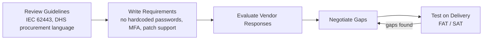

# 2026-10-19

**Study day.** Finished CISA 210W-04 (95%, 19/20) and wrote the first ICS attack case-study note (the France supermarket refrigeration attack). About 1.75h on the module plus 0.67h on the case study. Roadmap at about 5.2%, 6 of 60 tasks done.

### ICS Unpacked
- **Covered:** Tutored CISA 210W-04 (Cybersecurity Within IT and ICS Domains), completed with a certificate (1 contact hour), exam 19/20 (miss: field equipment connected directly to the internet is common). Concepts: why IT countermeasures can harm purpose-built control systems; IT and ICS share the same tech (Windows, Ethernet, databases) but different priorities (CIA vs AIC plus safety); determinism (predictable timing) and why steady ICS traffic suits IDS; minimal host applications (small attack surface); internet access benefits (remote support, vendor updates) vs risk; the 2017 Washington, D.C. police camera ransomware case; CIKR, CIP, NERC CIP; security requirements in procurement.
- **Takeaways:** Security tools must not break determinism. Internet access needs wrapping (VPN, MFA, jump host, allow-list), never a public IP on a controller. Internet-connected computers behind physical systems (cameras, HMIs) are the usual weak spot. Security is cheapest when written into the purchase contract.
- **Procurement flow (OT Lead):**

- **Decisions:** None; no new roadmap items.
- **Late session (refrigeration note):** A safety layer must be independent of the system it protects. The backup alarm ran on the compromised controller, so it failed with it. This is the core idea behind LOPA (Layer of Protection Analysis), a roadmap item.
- **Next:** 210W-05, then pump station hops 4-5. Security testing note: in OT, test on a lab copy, in planned outages, or passively, since aggressive scans can crash old PLCs.

### OT SE Quiz Helper
- **Covered:** Graded the refrigeration case-study quiz (3 questions). CISA 210W-04 practice checks and final exam, 95% (19/20).
- **Takeaways:** Case study: attackers got in through internet-exposed controllers with weak credentials. The French national cybersecurity agency (ANSSI) says take the gear offline because it's unsupported, so a reset doesn't fix it. A hardwired high-temp cutoff (SIS-style) stops the physical harm. 210W-04: IT traffic is irregular and on demand, ICS traffic is predictable. Confidentiality comes first for business systems. ICS change management means planned shutdowns. ICS support is around the clock, often can't run antivirus, and security testing can break it.
- **Decisions:** Exam miss was Q1 (field equipment connected directly to the internet is common, not uncommon). One practice explanation from the bot was wrong and got corrected to the course's version.
- **Next:** Re-quiz communication media and the 210W-03 slips, then 210W-05.

### ICS + OT Security Critique
- **Covered:** Graded the refrigeration-attack answers: Q3 strong (hardwired cutoff, tied to SIS), Q1 imprecise until corrected (internet exposure), Q2 needed the reason (unsupported gear). 210W-04 completed. Refrigeration case-study note drafted late evening: contractor remote access as the likely root cause, the alarm sharing the compromised system as a single point of failure, unconfirmed points flagged honestly. Ran a Shodan count of exposed refrigeration-controller panels in France as part of the case study.
- **Takeaways:** Four 210W modules in a week. The case-study note slipped three times before getting written; writing is the gap that keeps getting avoided. Shodan counts results, not sites, and its geolocation reflects ISP hubs, not real locations.
- **Gaps flagged:** Exposure and loss figures need sources; the section on why the fix was blunt is thin; no recommendations section yet.
- **Decisions:** Before the note goes public: cite every figure, put a date on any exposure count, blur IPs and hostnames, soften the losses line, and cite or drop the contractor detail.
- **Next:** Add sources and a short "what I'd do as OT lead" section, then 210W-05.

### OT + ICS News
- **Covered:** Fact-checked the refrigeration case-study note against SecurityWeek (Oct 13 and 15) and reviewed the draft.
- **Takeaways:** Censys counted nearly 3,000 exposed panels on Oct 11 (more than 1,800 in France). The entry path is still unconfirmed: either a date-based password or flaws Claroty disclosed. Reported losses are "millions of euros". Defrost cycles were stretched from 1 hour to 8, which delayed alarms. CERT-FR says remote access should come back only through a VPN.
- **Decisions:** The note should cite a source for every figure and end with a ranked "what would have stopped it" list.
- **Next:** Friday roundup Oct 23. Watch for attribution and the confirmed entry path.

### OT SE Journey
- **Covered:** Logged in the roadmap tracker: 210W-04 done (1.75h actual, quiz 19/20). Refrigeration note logged as case 1 under the ICS attack case-studies task (0.67h actual, including the Shodan check); task moved to In progress. Parked five skills from the job sweep (vulnerability-management lifecycle, SIEM/log monitoring, ISO/IEC 27001, FAT/SAT security testing, proposal writing).
- **Takeaways:** 6 of 60 tasks done, case-study task in progress. The note slipped but got done.
- **Decisions:** No 210W-05 until the note was written (met).
- **Next:** Cite sources in the note, then 210W-05 (1.75h est). Week 1-2 items still open: Purdue mapping, HART skim, Holcomb Getting Started PDF.

### Automated: OT SE JOBS weekly job sweep
_This sweep was produced automatically and is a reading queue, not completed work._

- **Covered:** First refined weekly job sweep for the Greater Toronto Area. No priority-employer OT security role this week. Four new postings overall (one practice-lead consulting role, two junior-to-mid engineering roles, one municipal vulnerability-management specialist role). Added three public-source leaders to the networking prep list.
- **Takeaways:** IEC 62443, incident response and firewall/segmentation work keep showing up. Vulnerability-management lifecycle, SIEM/log monitoring, ISO/IEC 27001, FAT/SAT security testing and proposal writing recur in 2+ postings. No posting asked for attack-surface or exposure-management skills. GICSP mentions stay at 3. Evening follow-up: suggested the case-study note end with a ranked recommendations section so it works as a portfolio piece.
- **Decisions:** No roadmap or gaps-list changes; new recurring skills parked for review. Outreach stays on hold until the ~35-hour gate.
- **Next:** Next sweep Monday Oct 26; keep counting GICSP and exposure-management asks until Dec 14.
